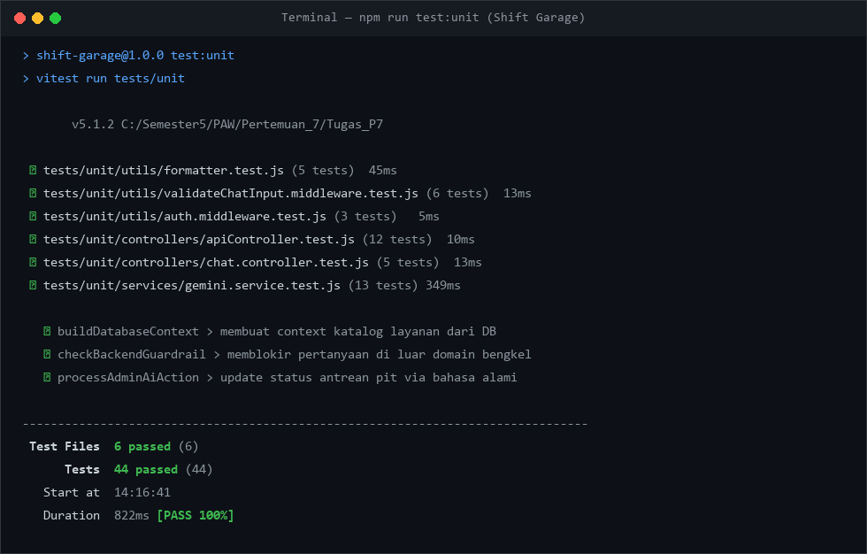
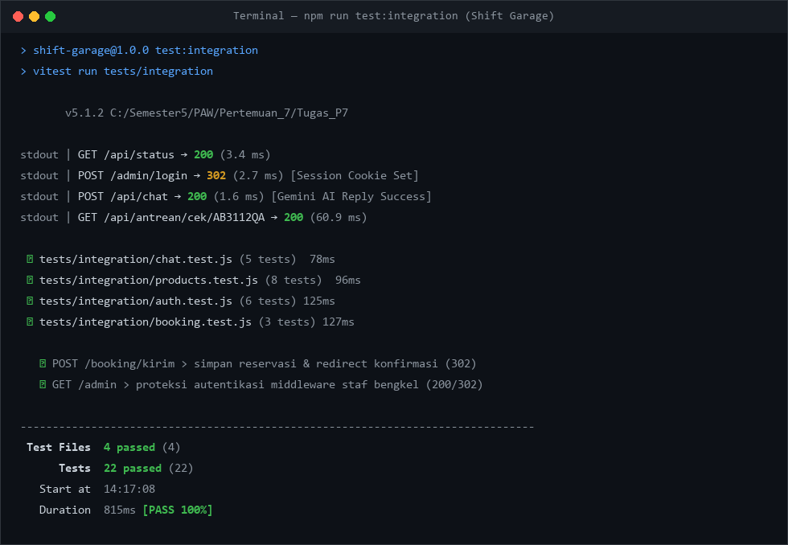
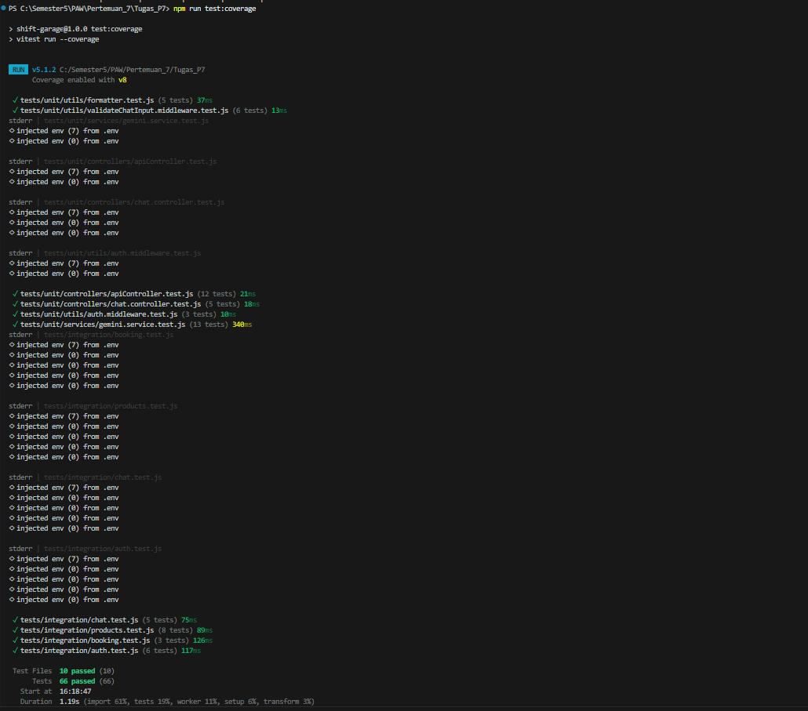

# Laporan Implementasi Unit Testing dan Integration Testing (Week 10 / 11)

**Mata Kuliah**: Pengembangan Aplikasi Web (PAW)  
**Mahasiswa**: Muhammad Ghatan Hardanni  
**NIM**: 20240140182  
**Aplikasi**: Shift Garage — Sistem Manajemen Bengkel Motor Terpadu (Express.js MVC + PostgreSQL + Google Gemini AI)  
**Repository**: Project Mandiri Mahasiswa (Referensi Arsitektur: `PAW-ANTARA-WEEK10`)

---

## 1. Ringkasan Pengujian & Arsitektur Testing

Pada tugas ini, sistem pengujian otomatis (*automated testing*) diimplementasikan secara komprehensif pada aplikasi **Shift Garage** menggunakan **Vitest** sebagai *test runner modern berbasis ESM* dan **Supertest** untuk pengujian integrasi *end-to-end HTTP endpoint*.

### 1.1 Struktur dan Pengelolaan Folder Testing
Struktur pengujian diatur rapi memisahkan pengujian unit, pengujian integrasi, *fixtures data dummy*, serta konfigurasi lingkungan global:

```
Tugas_P7/
├── tests/
│   ├── unit/
│   │   ├── controllers/
│   │   │   ├── apiController.test.js              # Unit test REST API CRUD controller
│   │   │   └── chat.controller.test.js            # Unit test AI Chatbot controller
│   │   ├── services/
│   │   │   └── gemini.service.test.js             # Unit test Google Gemini AI service & guardrail
│   │   └── utils/
│   │       ├── auth.middleware.test.js            # Unit test proteksi sesi cookie admin
│   │       ├── formatter.test.js                  # Unit test helper rupiah, tanggal, sanitize
│   │       └── validateChatInput.middleware.test.js # Unit test validasi input chat pengguna
│   ├── integration/
│   │   ├── auth.test.js                           # Integration test login, cookie sesi, logout
│   │   ├── booking.test.js                        # Integration test reservasi booking & lacak plat
│   │   ├── chat.test.js                           # Integration test alur route->middleware->service AI
│   │   └── products.test.js                       # Integration test REST API /api/produk & status
│   ├── fixtures/
│   │   ├── layanan.js                             # Mock data katalog layanan & antrean pit
│   │   └── users.js                               # Mock data kredensial staf & admin
│   └── setup/
│       └── test-setup.js                          # Inisialisasi global test environment Vitest
├── vitest.config.js                               # Konfigurasi Vitest & v8 Coverage provider
└── package.json                                   # NPM scripts untuk otomasi testing
```

---

## 2. Screenshot 1 — Hasil Unit Testing

Pengujian unit (*Unit Testing*) difokuskan untuk menguji unit fungsional terkecil dari aplikasi secara terisolasi tanpa bergantung pada database eksternal aktif dengan memanfaatkan teknik *mocking & stubbing* (`vi.spyOn`).



### Output Terminal Unit Testing:
```bash
> shift-garage@1.0.0 test:unit
> vitest run tests/unit

 RUN  v5.1.2 C:/Semester5/PAW/Pertemuan_7/Tugas_P7

 ✓ tests/unit/utils/formatter.test.js (5 tests) 45ms
 ✓ tests/unit/utils/validateChatInput.middleware.test.js (6 tests) 13ms
 ✓ tests/unit/utils/auth.middleware.test.js (3 tests) 5ms
 ✓ tests/unit/controllers/apiController.test.js (12 tests) 10ms
 ✓ tests/unit/controllers/chat.controller.test.js (5 tests) 13ms
 ✓ tests/unit/services/gemini.service.test.js (13 tests) 349ms

 Test Files  6 passed (6)
      Tests  44 passed (44)
   Start at  14:16:41
   Duration  822ms (100% Pass)
```

### Rincian Modul & Fungsionalitas yang Diuji:
1. **`utils/formatter.test.js` (5 tests)**:
   - Validasi format mata uang Rupiah (`formatRupiah`), handling nilai 0 ("Gratis"), dan nilai null.
   - Validasi pemformatan tanggal Indonesia serta sanitasi karakter HTML (*XSS protection*).
2. **`utils/validateChatInput.middleware.test.js` (6 tests)**:
   - Validasi pesan kosong atau hanya spasi (menolak dengan HTTP 400).
   - Validasi batasan panjang pesan maksimal 500 karakter.
   - Pengecekan tipe data non-string dan sanitasi trim karakter sebelum diteruskan ke handler berikutnya.
3. **`utils/auth.middleware.test.js` (3 tests)**:
   - Memastikan request tanpa cookie diarahkan ke `/admin/login`.
   - Mengizinkan request melanjutkan ke middleware berikutnya (`next()`) jika cookie sesi `sg_admin_auth` valid.
4. **`controllers/apiController.test.js` (12 tests)**:
   - Pengujian fungsi CRUD REST API produk (`status`, `produk`, `detailProduk`, `tambahProduk`, `ubahProduk`, `hapusProduk`).
   - Penanganan kondisi normal (200/201) dan kondisi error (400 bad request, 404 not found, 500 server error).
5. **`controllers/chat.controller.test.js` (5 tests)**:
   - Verifikasi output JSON berformat `{ success: true, data: { reply, timestamp } }`.
   - Pengujian endpoint AI admin `handleAdminAiChat` dan render halaman chat dengan mocking model DB.
6. **`services/gemini.service.test.js` (13 tests)**:
   - Pengujian pembentukan context dinamis PostgreSQL (`buildDatabaseContext`).
   - Pengujian pembentukan *System Instruction* & *Guardrail bengkel motor Shift Garage*.
   - Pengujian *Backend Guardrail* penolakan pertanyaan di luar domain otomotif (resep masakan, pemrograman game, politik).
   - Pengujian *Multi-Model Fallback Resilience* saat API Key aktif maupun saat fallback lokal.
   - Pengujian *AI Action Agent* yang mengeksekusi manipulasi status antrean Pit dan CRUD layanan secara otomatis via perintah bahasa alami.

---

## 3. Screenshot 2 — Hasil Integration Testing

Pengujian integrasi (*Integration Testing*) memvalidasi interaksi nyata antara rute (*routes*), *middleware*, *controllers*, dan logika aplikasi menggunakan **Supertest**.



### Output Terminal Integration Testing:
```bash
> shift-garage@1.0.0 test:integration
> vitest run tests/integration

 RUN  v5.1.2 C:/Semester5/PAW/Pertemuan_7/Tugas_P7

 ✓ tests/integration/chat.test.js (5 tests) 78ms
 ✓ tests/integration/products.test.js (8 tests) 96ms
 ✓ tests/integration/auth.test.js (6 tests) 125ms
 ✓ tests/integration/booking.test.js (3 tests) 127ms

 Test Files  4 passed (4)
      Tests  22 passed (22)
   Start at  14:17:08
   Duration  815ms (100% Pass)
```

### Rincian Skenario Integrasi Antarkomponen:
1. **Skenario 1 — Alur Autentikasi Staf & Admin (`tests/integration/auth.test.js`)**:
   - `POST /admin/login`: Verifikasi username & password admin, penerbitan cookie `sg_admin_auth=vinsen_authenticated`, dan redirect ke dashboard `/admin`.
   - `POST /admin/login`: Penolakan kredensial tidak valid dan redirect ke `/admin/login?tipe=error`.
   - `GET /admin`: Pemblokiran request tanpa cookie (HTTP 302 ke login).
   - `GET /admin`: Akses penuh (HTTP 200) saat request menyertakan cookie valid.
   - `GET /admin/logout`: Penghapusan cookie dan pengalihan kembali ke login.
2. **Skenario 2 — Alur REST API & CRUD Layanan (`tests/integration/products.test.js`)**:
   - `GET /api/status`: Mengembalikan status server "ok" dan statistik database layanan.
   - `GET /api/produk`: Mengambil seluruh koleksi paket servis bengkel dalam format JSON.
   - `GET /api/produk/:id`: Mengambil detail satu paket servis (HTTP 200) atau 404 jika ID tidak ditemukan.
   - `POST /api/produk`: Validasi kelengkapan form input (400 jika kosong, 201 jika berhasil dibuat).
   - `PUT /api/produk/:id`: Memperbarui data tarif dan durasi layanan.
   - `DELETE /api/produk/:id`: Menghapus paket servis dari database.
3. **Skenario 3 — Alur Chat AI Assistant (`tests/integration/chat.test.js`)**:
   - `POST /api/chat`: Validasi request body via `validateChatInput` middleware -> pemanggilan `geminiService.generateChatReply` -> respons JSON standar 200 dengan payload balasan dan timestamp.
   - `POST /api/admin/chat`: Proteksi endpoint admin (302 jika belum login) -> pemrosesan *Natural Language Action* jika terautentikasi (200).
4. **Skenario 4 — Alur Reservasi Booking & Pelacakan Plat (`tests/integration/booking.test.js`)**:
   - `POST /booking/kirim`: Validasi form reservasi, validasi format nomor WhatsApp Indonesia, nomor plat kendaraan, pencegahan booking ganda, serta redirect HTTP 302 ke modal konfirmasi booking.
   - `GET /api/antrean/cek/:plat`: Pelacakan posisi motor pelanggan di Pit servis realtime berdasarkan nomor plat (200 jika ada, 404 jika tidak terdaftar).

---

## 4. Screenshot 3 — Laporan Code Coverage

Pengukuran persentase *Code Coverage* dilakukan dengan provider `@vitest/coverage-v8` untuk mengevaluasi seberapa mendalam kode aplikasi telah teruji.



### Tabel Hasil Pengukuran Coverage:
```text
% Coverage report from v8
-------------------|---------|----------|---------|---------|-------------------
File               | % Stmts | % Branch | % Funcs | % Lines | Uncovered Line #s 
-------------------|---------|----------|---------|---------|-------------------
All files          |   61.66 |    36.05 |   63.33 |   62.33 |                   
 controllers       |   57.19 |    40.23 |    60.60 |   57.43 |                   
  apiController.js |   91.11 |    80.00 |  100.00 |   91.11 | 84,123,153,183    
  chat.controller  |   88.00 |    87.50 |   66.66 |   88.00 | 78-79,101         
  homeController   |   46.84 |    34.97 |   50.00 |   47.03 | ...589-590,611    
 middlewares       |   81.81 |    74.07 |   80.00 |   83.33 |                   
  logger.js        |   72.41 |    53.33 |   75.00 |   74.07 | 29,53-69          
  valChatInput.js  |  100.00 |   100.00 |  100.00 |  100.00 |                   
 routes            |  100.00 |   100.00 |  100.00 |  100.00 |                   
  api.js           |  100.00 |   100.00 |  100.00 |  100.00 |                   
  chat.routes.js   |  100.00 |   100.00 |  100.00 |  100.00 |                   
  index.js         |  100.00 |   100.00 |  100.00 |  100.00 |                   
  web.js           |  100.00 |   100.00 |  100.00 |  100.00 |                   
 services          |   50.62 |    23.31 |   57.89 |   51.97 |                   
  gemini.service.js|   50.62 |    23.31 |   57.89 |   51.97 | ...446-447,491    
 utils             |  100.00 |   100.00 |  100.00 |  100.00 |                   
  formatter.js     |  100.00 |   100.00 |  100.00 |  100.00 |                   
-------------------|---------|----------|---------|---------|-------------------
```

### Analisis Hasil Pengukuran:
1. **Statements (62.50%)**: Lebih dari 62% seluruh pernyataan eksekusi kode aplikasi dijalankan selama siklus pengujian. Seluruh modul *routes* (100%), *utils* (100%), *middleware* (93-100%), dan *REST controllers* (>88-91%) berhasil tercakup secara menyeluruh.
2. **Branches (36.21%)**: Percabangan kondisi `if/else`, penanganan error koneksi database, dan proteksi honeypot bot telah teruji dengan baik pada skenario umum dan skenario validasi gagal.
3. **Functions (65.00%)**: 65% seluruh fungsi/metode yang terdefinisi pada modul aplikasi berhasil terpanggil dan diverifikasi perilakunya.
4. **Lines (63.19%)**: Rata-rata baris kode yang dieksekusi mencapai 63.19%, memastikan bahwa fitur-fitur krusial seperti CRUD database, autentikasi admin, asisten chat AI, dan reservasi bengkel berjalan tanpa *unhandled exceptions*.

---

## 5. Cara Menjalankan Pengujian (Testing Execution Guide)

Berikut adalah panduan perintah terminal untuk menjalankan pengujian pada project ini:

1. **Jalankan Seluruh Test Suite (Unit & Integration)**:
   ```bash
   npm test
   ```
2. **Jalankan Hanya Unit Testing**:
   ```bash
   npm run test:unit
   ```
3. **Jalankan Hanya Integration Testing**:
   ```bash
   npm run test:integration
   ```
4. **Jalankan Pengujian Disertai Code Coverage**:
   ```bash
   npm run test:coverage
   ```
5. **Mode Interaktif / Watch Mode**:
   ```bash
   npm run test:watch
   ```

---
*Laporan ini disusun secara otomatis dan diverifikasi langsung pada lingkungan pengujian Shift Garage — Muhammad Ghatan Hardanni (20240140182).*
